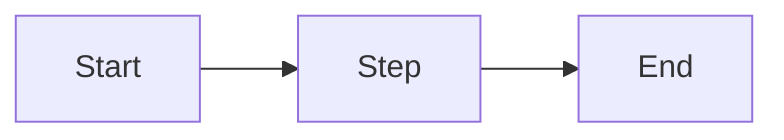

<!--
  HOW TO USE
  1. Copy this file to new-features/<name>.md or enhancements/<name>.md (snake_case).
  2. Replace every [placeholder]. Delete sections you don't need.
  3. Add a card to README.md under "## New Feature" or "## Enhancement":

  <a href="#/enhancements/[file_name]" style="color: inherit;">
    <div class="doc-card">
      <div class="doc-card-value" style="display: flex; justify-content: space-between; align-items: center;">
        <span>[Feature Title]</span>
        <span class="badge gray">Draft</span>
      </div>
      <p style="margin: 8px 0 0 0; font-size: 0.88em; color: var(--text-muted); font-weight: 400;">
        [One-line description.]
      </p>
    </div>
  </a>

  Badge colors: gray (Draft), yellow (In Review), green (Done), blue (version), red (Deprecated).
-->

# [Feature Title] <span class="badge gray">Draft</span>

[One or two sentences: what this does and who it is for.]

<div class="doc-grid cols-2">
  <div class="doc-card">
    <div class="doc-card-label">Problem</div>
    <div class="doc-card-value">[What is wrong or missing today]</div>
  </div>
  <div class="doc-card">
    <div class="doc-card-label">Solution</div>
    <div class="doc-card-value">[What changes]</div>
  </div>
</div>

?> [Key point the reader must know.]

## Flow

<div class="doc-steps">
  <div class="doc-step">
    <span class="doc-step-num">1</span>
    <div class="doc-step-body">
      <div class="doc-step-title">[Step title]</div>
      <div class="doc-step-desc">[What happens]</div>
    </div>
  </div>
  <div class="doc-step">
    <span class="doc-step-num">2</span>
    <div class="doc-step-body">
      <div class="doc-step-title">[Step title]</div>
      <div class="doc-step-desc">[What happens]</div>
    </div>
  </div>
</div>



## Endpoints

<div class="api-card">
  <div class="endpoint-bar">
    <span class="method get">GET</span>
    <code>/api/[resource]</code>
  </div>
  <p class="api-desc">[What it returns.]</p>

<details class="scalar-detail">
<summary>Request / Response</summary>

```json
{ "data": {} }
```

</details>
</div>

!> [Warning, limitation, or breaking change.]

## Notes

- [Open question, dependency, or rollout note]
