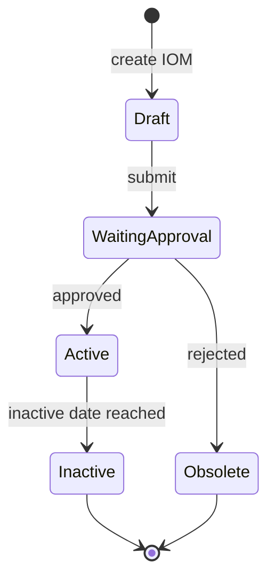
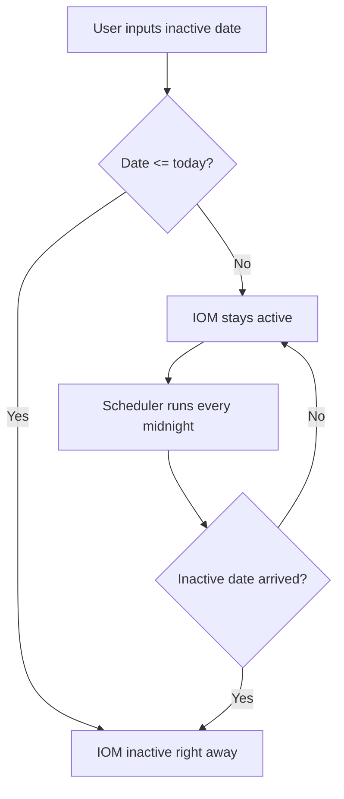

# IOM Version 2.0

Master IOM menu enhancement to provide workflow approval, automatic inactivation, and reupload attachment on approved data.

## Overview

<div class="doc-grid cols-2">
  <div class="doc-card">
    <div class="doc-card-label">🕒 Before</div>
    <div class="doc-card-value">No approval. Status is <code>active</code> or <code>inactive</code>. The user inactivates the IOM manually.</div>
  </div>
  <div class="doc-card">
    <div class="doc-card-label">✨ After</div>
    <div class="doc-card-value">Approval required. Status is <code>draft</code>, <code>active</code> or <code>inactive</code>. The user inputs an inactive date.</div>
  </div>
</div>

## Goals

?> **🎯 Goals**
- Every new IOM is approved before it becomes active.
- Users can replace the attachment of an approved IOM.
- IOM inactivation can be scheduled for a future date and runs automatically.

## Status and approval status

An IOM has two separate statuses: the IOM status and the approval status.

| Field | Values |
| :--- | :--- |
| **IOM status** | `draft`, `active`, `inactive` |
| **Approval status** | `draft`, `waiting approval`, and the decision result (`approved` or `rejected`) |

Both are stored in new fields on the IOM: `status` and `approval_status`. Before, the status was worked out on the fly from whether the inactive date was filled. Now `status` is a stored field with the values `draft`, `active` and `inactive`.

## Approval flow

?> A new IOM starts as `draft` with approval status `draft`. Submitting only changes the approval status. The IOM status stays `draft` until the approver decides.



<div class="doc-steps">
  <div class="doc-step">
    <span class="doc-step-num">1</span>
    <div class="doc-step-body">
      <div class="doc-step-title">Create</div>
      <div class="doc-step-desc">The user creates an IOM. IOM status is <code>draft</code> and approval status is <code>draft</code>.</div>
    </div>
  </div>
  <div class="doc-step">
    <span class="doc-step-num">2</span>
    <div class="doc-step-body">
      <div class="doc-step-title">Submit</div>
      <div class="doc-step-desc">The user submits the IOM. IOM status stays <code>draft</code>. Approval status becomes <code>waiting approval</code>.</div>
    </div>
  </div>
  <div class="doc-step">
    <span class="doc-step-num">3</span>
    <div class="doc-step-body">
      <div class="doc-step-title">Approve</div>
      <div class="doc-step-desc">The IOM status becomes <code>active</code>.</div>
    </div>
  </div>
  <div class="doc-step">
    <span class="doc-step-num">4</span>
    <div class="doc-step-body">
      <div class="doc-step-title">Reject</div>
      <div class="doc-step-desc">The IOM data becomes <code>obsolete</code>.</div>
    </div>
  </div>
</div>

## Reupload attachment

On an approved IOM, the user can reupload the attachment through a new endpoint. The new file replaces the current attachment.

?> Reupload is only available on an approved IOM.

### Sales Validation check

When an IOM is reuploaded, the system checks whether any Sales Validation uses that IOM.

<div class="doc-steps">
  <div class="doc-step">
    <span class="doc-step-num">1</span>
    <div class="doc-step-body">
      <div class="doc-step-title">Find the Sales Validations that use the IOM</div>
      <div class="doc-step-desc">If there is none, the reupload goes ahead and nothing else changes.</div>
    </div>
  </div>
  <div class="doc-step">
    <span class="doc-step-num">2</span>
    <div class="doc-step-body">
      <div class="doc-step-title">Check the status</div>
      <div class="doc-step-desc">If any of those Sales Validations is <code>waiting approval</code>, the reupload is blocked. If they are all editable (<code>draft</code> or <code>rejected</code>), the reupload goes ahead.</div>
    </div>
  </div>
  <div class="doc-step">
    <span class="doc-step-num">3</span>
    <div class="doc-step-body">
      <div class="doc-step-title">Update the document log</div>
      <div class="doc-step-desc">For each editable Sales Validation, every detail with the same <code>document_type_id</code> that used the old document log gets its <code>document_log_id</code> set to the new document log.</div>
    </div>
  </div>
</div>

!> **Important:** If any Sales Validation that uses the IOM is `waiting approval`, the user can't reupload the IOM.

See `PUT /upload/{id}` in [API endpoints](#api-endpoints).

## Inactivation

The user no longer toggles the status directly. Instead, the user inputs an **inactive date**. The system compares it with today's date.

| Inactive date | Result |
| :--- | :--- |
| **Today or earlier** | The IOM becomes `inactive` right away |
| **After today** | The IOM stays `active` until the scheduler inactivates it |

The inactive date can't be earlier than `start_date`. For example, if `start_date` is `01-01-2028` and the user picks `22-10-2027`, the request is rejected with `400`. See `PUT /inactivate/{id}` in [API endpoints](#api-endpoints).

### Scheduler

!> **Warning:** A scheduler runs every midnight. It checks every active IOM that has an inactive date. If the inactive date has arrived, the scheduler sets the IOM to `inactive` automatically.



## API endpoints

### Reupload attachment

<div class="api-card">
  <div class="endpoint-bar">
    <span class="method put">PUT</span>
    <code>/upload/{id}</code>
  </div>
  <p class="api-desc">Uploads a new attachment file for an approved IOM.</p>
</div>

**Request** (`multipart/form-data`)

| Field | Type | Description |
| :--- | :--- | :--- |
| `file` | `file` | The new attachment to upload |

<details class="scalar-detail">
<summary>Response Payload — <code>PUT /upload/{id}</code></summary>

```json
{
  "message": "Data updated correctly",
  "meta": {},
  "data": {
    "id": "string",
    "number": "string",
    "name": "string",
    "type": "enum",
    "free_qty": 0,
    "start_date": "date",
    "end_date": "date",
    "notes": "string",
    "max_usage": 0,
    "inactive_date": "date",
    "effective_from_months": 0,
    "free_type": "enum",
    "amount": 0,
    "iom_date": "date",
    "status": "enum",
    "approval_status": "enum",
    "attachment": {
      "id": "string",
      "file_name": "string",
      "file_url": "string",
      "document_type_id": "string",
      "document_type_description": "string"
    },
    "details": [
      {
        "id": "string",
        "iom_id": "string",
        "project_id": "string",
        "project_code": "string",
        "project_name": "string",
        "sub_project_id": "string",
        "sub_project_code": "string",
        "sub_project_name": "string"
      }
    ],
    "ajb_details": [
      {
        "id": "string",
        "iom_id": "string",
        "cost_type": "enum",
        "amount": 0
      }
    ]
  }
}
```

</details>

### Inactivate

<div class="api-card">
  <div class="endpoint-bar">
    <span class="method put">PUT</span>
    <code>/inactivate/{id}</code>
  </div>
  <p class="api-desc">Sets the inactive date of an IOM. The endpoint now receives the inactive date and uses it to decide whether to inactivate the IOM right away or leave it for the scheduler.</p>
</div>

**Request**

| Field | Type | Description |
| :--- | :--- | :--- |
| `inactive_date` | `date` | Date the IOM becomes inactive. Compared with today's date |

**Logic**
- `inactive_date` is earlier than `start_date`: rejected with `400`.
- `inactive_date` is today or earlier (and not earlier than `start_date`): `status` becomes `inactive` right away.
- `inactive_date` is after today: the date is saved and `status` stays `active`. The scheduler inactivates it when the date arrives.

**Responses**
- <span class="badge green">200</span> Updated
- <span class="badge yellow">400</span> `inactive_date` is earlier than `start_date`
- <span class="badge yellow">404</span> IOM not found

<details class="scalar-detail" open>
<summary>Request Payload — <code>PUT /inactivate/{id}</code></summary>

```json
{
  "inactive_date": "date"
}
```

</details>

<details class="scalar-detail">
<summary>Response Payload — <code>PUT /inactivate/{id}</code></summary>

```json
{
  "message": "Data updated correctly",
  "meta": {},
  "data": {
    "id": "string",
    "number": "string",
    "name": "string",
    "type": "enum",
    "free_qty": 0,
    "start_date": "date",
    "end_date": "date",
    "notes": "string",
    "max_usage": 0,
    "inactive_date": "date",
    "effective_from_months": 0,
    "free_type": "enum",
    "amount": 0,
    "iom_date": "date",
    "status": "enum",
    "approval_status": "enum"
  }
}
```

</details>

## Removed endpoints

!> **Important:** These endpoints are removed.

| Endpoint | Why |
| :--- | :--- |
| `PUT /activate/{id}` | An IOM becomes `active` automatically when it is approved, so there is no manual activation |
| `DELETE /{id}` | An IOM is no longer deleted. The `is_deleted` field is removed from the data model, responses and checks |