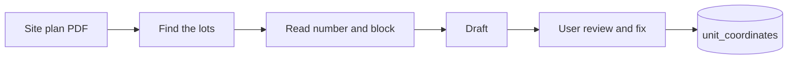

# Site Plan Mapping

Units on a site plan are marked by hand, one by one, again on every map change. Site Plan Mapping detects them from the site plan PDF and returns a draft mapping, a point or a polygon per unit, for the user to review before saving. Take note that all tests done below is using Pesona Indah Cemara Medan (PICM) project and its derivative (sub project group, sub project, and unit) as pilot project.

## Overview

<div class="doc-grid">
  <div class="doc-card">
    <div class="doc-card-label">✏️ Status</div>
    <div class="doc-card-value"><span class="badge gray">Draft</span></div>
  </div>
  <div class="doc-card">
    <div class="doc-card-label">👤 Owner</div>
    <div class="doc-card-value">Alfin Wijaya</div>
  </div>
  <div class="doc-card">
    <div class="doc-card-label">🧩 Related services</div>
    <div class="doc-card-value">Sales Service, Cloud Storage</div>
  </div>
</div>

<div class="doc-grid cols-2">
  <div class="doc-card">
    <div class="doc-card-label">Problem</div>
    <div class="doc-card-value">Manual mapping on every map change takes too much time</div>
  </div>
  <div class="doc-card">
    <div class="doc-card-label">Solution</div>
    <div class="doc-card-value">Detect every unit automatically, then let the user review and fix it</div>
  </div>
</div>

## Goals

<div class="doc-callout">
  <div class="doc-callout-title">🎯 Goals</div>
  <ul>
    <li>User gets a default mapping and can change it manually.</li>
    <li>Cut the time needed to mark every unit one by one.</li>
    <li>Introduce polygon shape to mark every unit on site plan.</li>
  </ul>
</div>

## How it works

The system reads a site plan the way a person would. First it finds the boxes on the drawing, then it reads what is written in them.



<div class="doc-steps">
  <div class="doc-step">
    <span class="doc-step-num">1</span>
    <div class="doc-step-body">
      <div class="doc-step-title">Look at the drawing</div>
      <div class="doc-step-desc">The site plan is opened twice: once as a picture to see the lines, and once to read the text printed on it, such as house numbers and block names, with their exact position.</div>
    </div>
  </div>
  <div class="doc-step">
    <span class="doc-step-num">2</span>
    <div class="doc-step-body">
      <div class="doc-step-title">Find the boxes</div>
      <div class="doc-step-desc">Anything that isn't white counts as a line. The text is removed first so a house number doesn't break its box. Every white area closed in by lines becomes a shape.</div>
    </div>
  </div>
  <div class="doc-step">
    <span class="doc-step-num">3</span>
    <div class="doc-step-body">
      <div class="doc-step-title">Keep only the lots</div>
      <div class="doc-step-desc">Roads and open areas are much bigger than a lot, so they are dropped. Small pieces, such as a carport, join the lot next to them across a thin line, never across a thick block border.</div>
    </div>
  </div>
  <div class="doc-step">
    <span class="doc-step-num">4</span>
    <div class="doc-step-body">
      <div class="doc-step-title">Read the house number</div>
      <div class="doc-step-desc">The biggest number or short code inside the lot: <span class="doc-chip">12</span> <span class="doc-chip">1A</span> <span class="doc-chip">LOT-A</span>. Lot sizes like <span class="doc-chip">5X15</span> are ignored.</div>
    </div>
  </div>
  <div class="doc-step">
    <span class="doc-step-num">5</span>
    <div class="doc-step-body">
      <div class="doc-step-title">Find the block</div>
      <div class="doc-step-desc">Each row of lots takes the nearest block label, such as <span class="doc-chip">BLOK C</span> or <span class="doc-chip">EROPA 6</span>. Labels that match no unit, such as <span class="doc-chip">ROW 10</span>, are ignored. Words every unit shares, like the project name, don't count.</div>
    </div>
  </div>
  <div class="doc-step">
    <span class="doc-step-num">6</span>
    <div class="doc-step-body">
      <div class="doc-step-title">Put them together</div>
      <div class="doc-step-desc">Block + house number = unit. Each unit goes to one lot only. Nothing is guessed: anything left over goes on a review list.</div>
    </div>
  </div>
  <div class="doc-step">
    <span class="doc-step-num">7</span>
    <div class="doc-step-body">
      <div class="doc-step-title">Review and save</div>
      <div class="doc-step-desc">The user sees the matched units, shapes with no unit, and units with no shape, fixes what is wrong, and saves.</div>
    </div>
  </div>
</div>

#### Example of the unit code reading

<div class="doc-grid">
  <div class="doc-card">
    <div class="doc-card-label">Block label</div>
    <div class="doc-card-value">BLOK C</div>
  </div>
  <div class="doc-card">
    <div class="doc-card-label">+ House number</div>
    <div class="doc-card-value">5</div>
  </div>
  <div class="doc-card">
    <div class="doc-card-label">= Unit</div>
    <div class="doc-card-value">RKDC-05</div>
  </div>
</div>

!> **Needs a real PDF, not a picture.** The house numbers are read from the PDF's text. Images and scanned PDFs have no text, so lots are found but no unit is matched. Quick check: open the PDF and search a house number with **Ctrl+F**. If it's found, the file works.

## Known limits

Finding the boxes works well. Reading the labels is the hard part. These real maps broke it, and each was fixed:

<div class="doc-grid">
  <div class="doc-card">
    <div class="doc-card-label">Victoria CBD</div>
    <div class="doc-card-value">Extra words in the label: "BLOK C (5X15) (20 UNIT)"</div>
    <p class="api-desc" style="margin: 6px 0 0;">Fix: only words that can name a block are used.</p>
  </div>
  <div class="doc-card">
    <div class="doc-card-label">Kavling</div>
    <div class="doc-card-value">Letters instead of numbers: "LOT-A" to "LOT-H"</div>
    <p class="api-desc" style="margin: 6px 0 0;">Fix: any short code works. A code used once in the group matches without a block.</p>
  </div>
  <div class="doc-card">
    <div class="doc-card-label">Eropa</div>
    <div class="doc-card-value">The block name is a number: "EROPA 6"</div>
    <p class="api-desc" style="margin: 6px 0 0;">Fix: a number next to a known word names a block.</p>
  </div>
</div>

?> A new map may be drawn in a way nobody has seen yet. The goal is never to be silently wrong. That's why the result is always a draft, and a low `confidence` means a person should check it.
## Point or polygon

Both modes use the same `points` list, for detection and for saving.

<div class="doc-tabs">
  <div class="doc-tab-bar">
    <button class="doc-tab-btn active" data-tab="point">Point</button>
    <button class="doc-tab-btn" data-tab="polygon">Polygon</button>
  </div>
  <div class="doc-tab active" data-tab="point">
    <svg viewBox="0 0 120 80" class="doc-lot"><rect x="15" y="8" width="90" height="64" class="doc-lot-box"/><text x="60" y="42" class="doc-lot-num">12</text><circle cx="60" cy="41" r="15" class="doc-lot-dot"/></svg>
    <div class="doc-tab-text">
      <div class="doc-tab-title">1 item</div>
      <div class="doc-tab-desc">A single point on the house number.</div>
<pre class="doc-tab-code">[{ "x_position": 1450.6, "y_position": 2208.7, "point_index": 0 }]</pre>
    </div>
  </div>
  <div class="doc-tab" data-tab="polygon">
    <svg viewBox="0 0 120 80" class="doc-lot"><rect x="15" y="8" width="90" height="64" class="doc-lot-box doc-lot-fill"/><text x="60" y="42" class="doc-lot-num">12</text><circle cx="15" cy="8" r="3.5" class="doc-lot-corner"/><circle cx="105" cy="8" r="3.5" class="doc-lot-corner"/><circle cx="105" cy="72" r="3.5" class="doc-lot-corner"/><circle cx="15" cy="72" r="3.5" class="doc-lot-corner"/></svg>
    <div class="doc-tab-text">
      <div class="doc-tab-title">3 or more items</div>
      <div class="doc-tab-desc">The lot outline, corners in order.</div>
<pre class="doc-tab-code">[{ "x_position": 1450.6, "y_position": 2208.7, "point_index": 0 },
 { "x_position": 1451.7, "y_position": 2412.4, "point_index": 1 },
 { "x_position": 1339.0, "y_position": 2413.5, "point_index": 2 },
 { "x_position": 1300.1, "y_position": 2210.1, "point_index": 3 }]</pre>
    </div>
  </div>
</div>

?> Coordinates are pixels of the rendered page, sized `image_width` × `image_height`. Display the same page and scale by these values.

## Data model

Current <code>unit_coordinates</code> table only able to hold 1 point per unit with <code>x_position</code> and <code>y_position</code>. With new requirement we need to 

### Unit Coordinates

| Field | Type | Change | Description |
| :--- | :--- | :--- | :--- |
| `unit_id` | `string` | | Unit this mapping belongs to |
| `x_position` | `float` | <span class="badge red">Removed</span> | Replaced by `points` |
| `y_position` | `float` | <span class="badge red">Removed</span> | Replaced by `points` |
| `points` | `list[dict]` | <span class="badge green">Added</span> | List of information that hold the unit position on a site plan <br><br> Point: [ { "x_position": <code>float</code>, "y_position": <code>float</code>, "point_index": <code>int</code> } ] <br><br> Polygon: [ { "x_position": <code>float</code>, "y_position": <code>float</code>, "point_index": <code>int</code> }, {"x_position": <code>float</code>, "y_position": <code>float</code>, "point_index": <code>int</code>} , {.....} ]|
| `is_deleted` | `bool` | | Mark that the coordinate already replaced by a newer version |

!> **Breaking change.** The `x_position` / `y_position` columns are replaced by `points`. Migration turns existing rows into 1-point lists. The frontend switches in the same release.

## API endpoints

### Auto Detect

<div class="api-card">
  <div class="endpoint-bar">
    <span class="method post">POST</span>
    <code>/unit_coordinates/auto_detect</code>
  </div>
  <p class="api-desc">Detects units and returns a draft. Nothing is saved.</p>
</div>

**Responses**
- <span class="badge green">200</span> Draft returned
- <span class="badge yellow">400</span> File empty, unsupported or unreadable
- <span class="badge yellow">404</span> No units in the group, or no site plan to use
- <span class="badge yellow">413</span> File larger than 30 MB
- <span class="badge red">502</span> Stored site plan could not be downloaded
- <span class="badge red">500</span> Unexpected backend error

<details class="scalar-detail">
<summary>Request (multipart/form-data)</summary>

- **`sub_project_group_id`** · required. Group whose units are matched.
- **`file`** · optional. Site plan PDF. Empty = the group's stored site plan.
- **`mode`** · optional. `point` or `polygon`, default `polygon`.
- **`include_image`** · optional. Also return the rendered page as base64 JPEG.

</details>

<details class="scalar-detail">
<summary>Response payload</summary>

```json
{
  "data": {
    "mode": "point",
    "image_width": 4764,
    "image_height": 3368,
    "matched": [
      {
        "unit_id": "string",
        "unit_code": "string",
        "confidence": "number",
        "points": [
          { "x_position": "number", "y_position": "number", "point_index": 0 }
        ]
      }
    ],
    "unmatched_shapes": [
      {
        "detected_number": "string",
        "points": [
          { "x_position": "number", "y_position": "number", "point_index": 0 }
        ]
      }
    ],
    "units_without_shape": [
      { "unit_id": "string", "unit_code": "string" }
    ],
    "warnings": ["string"],
    "image": "string"
  }
}
```

</details>

### Save

<div class="api-card">
  <div class="endpoint-bar">
    <span class="method put">PUT</span>
    <code>/unit_coordinates/sub_project_group/{sub_project_group_id}</code>
  </div>
  <p class="api-desc">Saves the reviewed mapping for the whole group. Units left out are soft-deleted. Also per sub project, and as add-only <b>POST</b> on the same paths.</p>
</div>

**Validation**
- `points` has 1 item, or 3 or more.
- `point_index` runs `0` to `n-1`, no gaps or duplicates.
- Coordinates are not negative, and a polygon doesn't repeat a corner.
- The same shape isn't sent twice.

**Responses**
- <span class="badge green">200</span> Saved
- <span class="badge yellow">400</span> Same shape twice in the request
- <span class="badge yellow">422</span> `points` doesn't pass validation
- <span class="badge red">500</span> Unexpected backend error

<details class="scalar-detail">
<summary>Request payload</summary>

```json
[
  {
    "unit_id": "string",
    "points": [
      { "x_position": "number", "y_position": "number", "point_index": 0 }
    ]
  }
]
```

</details>

### List

<div class="api-card">
  <div class="endpoint-bar">
    <span class="method get">GET</span>
    <code>/unit_coordinates/no_page</code>
  </div>
  <p class="api-desc">Saved mappings with unit code and sales status. Filter by sub project or sub project group. Paginated version: <b>GET /unit_coordinates</b>.</p>
</div>

**Responses**
- <span class="badge green">200</span> Data fetched
- <span class="badge red">500</span> Internal server error

<details class="scalar-detail">
<summary>Response payload</summary>

```json
{
  "data": [
    {
      "id": "string",
      "unit_id": "string",
      "points": [
        { "x_position": "number", "y_position": "number", "point_index": 0 }
      ],
      "code": "string",
      "descs": "string",
      "sales_status": "string"
    }
  ]
}
```

</details>

## Error handling

| Code | Client action |
| :--- | :--- |
| <span class="badge yellow">400</span> | Upload a vector PDF, or remove the duplicate shape |
| <span class="badge yellow">404</span> | Upload a site plan, or check the group |
| <span class="badge yellow">413</span> | Export a smaller PDF |
| <span class="badge yellow">422</span> | Send 1 point, or 3 or more corners in order |
| <span class="badge red">502</span> | Retry, or upload the file in the request |
| <span class="badge red">500</span> | Retry later, then contact the backend team |

## Testing

- **Regression:** units drawn on all known site plans, all matched. A new drawing style may match fewer, so a low `confidence` means check it.
- **Unit tests:** `tests/test_site_plan_detection_service.py`, `tests/test_unit_coordinates_points.py`.
- **Manual:** viewer at `{API_PREFIX}/static/site_plan_viewer.html`.
