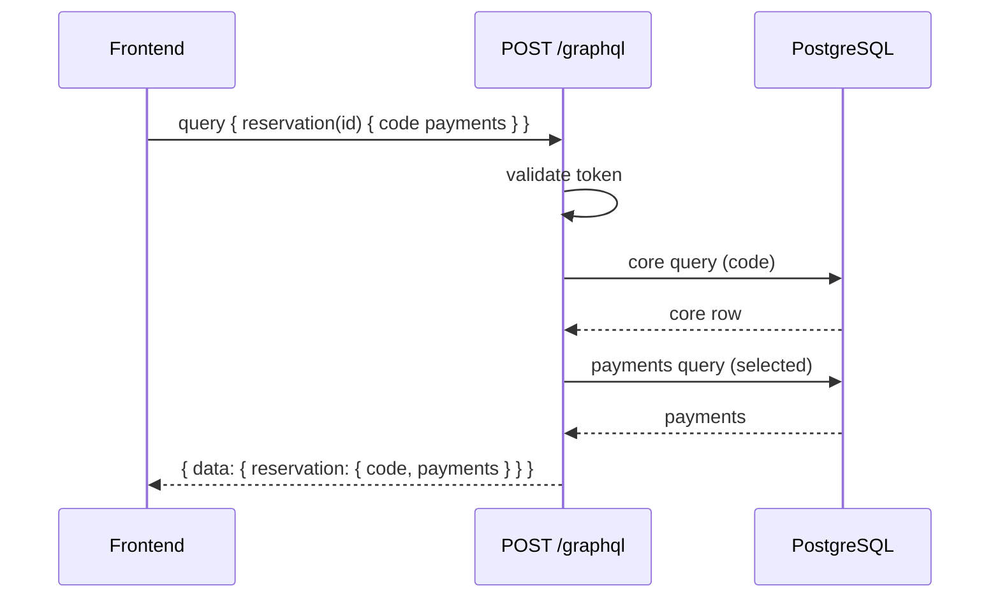

# GraphQL Reservation Detail

An alternative to `GET /reservation/{id}?include=...`. The client sends a query that lists the fields it wants. Sales Service only fetches what was selected. Asking for `code` runs 1 SQL query. Asking for everything runs the same data as REST.

## Overview

<div class="doc-grid">
  <div class="doc-card">
    <div class="doc-card-label">✏️ Status</div>
    <div class="doc-card-value"><span class="badge gray">Draft</span></div>
  </div>
  <div class="doc-card">
    <div class="doc-card-label">👤 Owner</div>
    <div class="doc-card-value">Alfin Wijaya</div>
  </div>
  <div class="doc-card">
    <div class="doc-card-label">🧩 Related services</div>
    <div class="doc-card-value">Sales Service</div>
  </div>
</div>

## Goals

?> **🎯 Goals**
- Frontend fetches only the reservation data a screen needs, in one request.
- Frontend can compare REST (`include=`) and GraphQL on the same data and choose.
- Adding GraphQL for another resource needs no change to the existing ones.

## REST or GraphQL?

| Situation | Use |
| :--- | :--- |
| Screen needs a few fields or one or two relations | <span class="badge blue">GraphQL</span> fetches only the selection |
| Screen needs everything the detail returns | <span class="badge gray">Either</span> the data and speed are about equal |
| Need typed Swagger contract for nested objects | <span class="badge gray">REST</span> nested GraphQL relations are untyped JSON |
| Need standard HTTP status codes | <span class="badge gray">REST</span> GraphQL errors come in the body |

## Architecture

?> Scalar columns come from one lightweight core query. Each relation is a **lazy field**: its query runs only if the client selects it.



## Endpoint

<div class="api-card">
  <div class="endpoint-bar">
    <span class="method post">POST</span>
    <code>/graphql</code>
  </div>
  <p class="api-desc">Runs a GraphQL query. Send <code>{"query": "..."}</code> with the same <code>Authorization: Bearer</code> token as REST.</p>
</div>

<div class="api-card">
  <div class="endpoint-bar">
    <span class="method get">GET</span>
    <code>/graphql</code>
  </div>
  <p class="api-desc">Opens the interactive playground in a browser. Add the <code>Authorization</code> header in the playground's headers panel.</p>
</div>

!> **Important:** The full path is `{API_PREFIX}/graphql`. Field names are `snake_case`, the same as REST.

## Try it

### 1. Minimal: core fields only (1 query)

```graphql
query {
  reservation(id: "01K58GMS0W9MB0PQ4Y19EAEBMZ") {
    code
    status
  }
}
```

```json
{
  "data": {
    "reservation": { "code": "string", "status": "confirm 2" }
  }
}
```

### 2. Add relations (one query per relation)

```graphql
query {
  reservation(id: "01K58GMS0W9MB0PQ4Y19EAEBMZ") {
    code
    payments
    extension_histories
  }
}
```

### 3. Full detail screen

```graphql
query {
  reservation(id: "01K58GMS0W9MB0PQ4Y19EAEBMZ") {
    id code status unit_code customer_name sales_amount paid_amount
    reservation_customers
    reservation_contacts
    active_unit_prices
    reservation_ioms
    reservation_barters
    attachments
    virtual_accounts
    is_outstanding_fine
    payments
    extension_histories
    file_histories
    confirmation_progress
    existing_customers
  }
}
```

### Call it from code

<details class="scalar-detail" open>
<summary>fetch (JavaScript)</summary>

```js
const res = await fetch(`${API_PREFIX}/graphql`, {
  method: "POST",
  headers: {
    "Content-Type": "application/json",
    Authorization: `Bearer ${token}`,
  },
  body: JSON.stringify({
    query: `query ($id: String!) { reservation(id: $id) { code payments } }`,
    variables: { id: reservationId },
  }),
});
const { data, errors } = await res.json();
```

</details>

<details class="scalar-detail">
<summary>curl</summary>

```bash
curl -X POST "$API_PREFIX/graphql" \
  -H "Authorization: Bearer $TOKEN" \
  -H "Content-Type: application/json" \
  -d '{"query":"{ reservation(id: \"01K58GMS0W9MB0PQ4Y19EAEBMZ\") { code status } }"}'
```

</details>

## Field reference

### Core fields (no extra query)

All come from one query. Selecting any number of them costs the same.

| Group | Fields |
| :--- | :--- |
| Identity and audit | `id`, `code`, `created_by`, `created_at`, `updated_by`, `updated_at`, `is_deleted` |
| Status and dates | `status`, `status_alih_hak`, `in_review_date`, `in_review_expiry_date`, `waiting_for_paid_date`, `waiting_for_paid_expiry_date`, `confirm_1_date`, `confirm_1_expiry_date`, `confirm_2_date`, `cancel_date`, `reopen_date`, `ppjb_generate_date`, `bast_date`, `bast_datetime` |
| Unit and project | `unit_id`, `unit_code`, `unit_description`, `company_id`, `company_code`, `company_name`, `project_id`, `project_code`, `project_name`, `sub_project_id`, `sub_project_code`, `sub_project_name`, `group_id`, `group_description` |
| Sales | `sales_person_id`, `sales_person_name`, `sales_person_type`, `sales_person_manager_name`, `source_product_info_id`, `source_product_info_description`, `other_source_product_info`, `is_sales_group` |
| Customer | `customer_id`, `customer_code`, `customer_name`, `ownership_name`, `lead_names`, `va_suffix` |
| Amounts | `sales_amount`, `dpp_amount`, `ppn_amount`, `commitment_fee`, `commitment_fee_amount`, `sales_marketing_amount`, `sales_marketing_number_of_payments`, `promo_gift_amount`, `transaction_amount`, `paid_amount` |
| Flags | `is_HOP`, `is_VVIP`, `is_LPTD`, `is_anjak`, `is_developer_load`, `is_dividend_sales`, `is_ppn_incentive`, `is_cancel_input`, `is_in_review_extension`, `is_initial_confirm_2`, `is_kpr_lunas`, `is_kpr_secondary_lunas` |
| Other | `opportunity_id`, `payment_method`, `payment_method_secondary`, `barter_type`, `note`, `internal_note`, `cancel_input_note`, `profit_center` |

### Lazy fields (one query each, only if selected)

| Field | REST equivalent | Returns |
| :--- | :--- | :--- |
| `reservation_customers` | included in `GET /reservation/{id}` | Customers with lead and customer data |
| `reservation_contacts` | included in `GET /reservation/{id}` | Contact persons |
| `active_unit_prices` | included in `GET /reservation/{id}` | Prices with details, gifts and programs |
| `reservation_ioms` | included in `GET /reservation/{id}` | IOMs |
| `reservation_barters` | included in `GET /reservation/{id}` | Barters |
| `attachments` | included in `GET /reservation/{id}` | Document attachments |
| `virtual_accounts` | included in `GET /reservation/{id}` | Virtual accounts |
| `is_outstanding_fine` | included in `GET /reservation/{id}` | `boolean`, BAST fine outstanding |
| `payments` | `?include=payments` | Reservation payments |
| `extension_histories` | `?include=extension_histories` | Extension histories |
| `file_histories` | `?include=file_histories` | File histories |
| `confirmation_progress` | `?include=confirmation_progress` | Latest confirmation progress |
| `existing_customers` | `?include=existing_customers` | Customers sharing a lead's `business_id`, excluding already linked customers |

!> **Warning:** Lazy fields are returned as raw JSON. Do not add a sub-selection such as `payments { amount }`. Select the field name only and read the keys from the JSON.

<details class="scalar-detail">
<summary>Queries run per selection</summary>

| Selection | SQL queries |
| :--- | :--- |
| `{ code }` or `{ code status }` | 1 |
| `{ code payments }` | 2 |
| `{ code is_outstanding_fine }` | 2 |
| `{ code active_unit_prices }` | 5 |
| `{ code reservation_customers }` | 6 |

</details>

## Errors

GraphQL returns HTTP `200` for query errors. Check the `errors` array in the body.

```json
{
  "data": { "reservation": null },
  "errors": [{ "message": "Reservation with id ... not found", "path": ["reservation"] }]
}
```

| Case | What the client gets | Client action |
| :--- | :--- | :--- |
| <span class="badge yellow">Unknown id</span> | `errors[0].message`, `data.reservation` is `null` | Refresh the list. The record may not exist |
| <span class="badge yellow">Unknown field</span> | Validation error in `errors` | Fix the query. Field names are `snake_case` |
| <span class="badge red">Missing or invalid token</span> | HTTP error from the auth check, before the query runs | Sign in again |
| <span class="badge red">Server error</span> | `errors` with a message, other fields may still return | Retry later. If it keeps failing, contact the backend team |

## How it works

<div class="doc-steps">
  <div class="doc-step">
    <span class="doc-step-num">1</span>
    <div class="doc-step-body">
      <div class="doc-step-title">Authenticate</div>
      <div class="doc-step-desc">The router uses the same <code>Permission().get_login_user</code> as REST and puts the user in the request context.</div>
    </div>
  </div>
  <div class="doc-step">
    <span class="doc-step-num">2</span>
    <div class="doc-step-body">
      <div class="doc-step-title">Fetch the core row</div>
      <div class="doc-step-desc">The <code>reservation</code> resolver runs one lightweight query for the scalar columns. It raises not found if the id does not exist.</div>
    </div>
  </div>
  <div class="doc-step">
    <span class="doc-step-num">3</span>
    <div class="doc-step-body">
      <div class="doc-step-title">Resolve selected relations</div>
      <div class="doc-step-desc">Each selected lazy field runs its own query. Fields not selected never run.</div>
    </div>
  </div>
  <div class="doc-step">
    <span class="doc-step-num">4</span>
    <div class="doc-step-body">
      <div class="doc-step-title">Return only the selection</div>
      <div class="doc-step-desc">The response has exactly the shape of the query.</div>
    </div>
  </div>
</div>

!> **Important:** All lazy fields of one request share a single database session, so they run **one after another**, not in parallel. A per-request lock enforces this. Selecting many relations costs the sum of their queries.

## Limitations

- Nested relations are untyped JSON. Only the core fields are typed.
- Read only. There is no mutation.
- Only `reservation(id)` exists today. There is no list query.
- Swagger does not describe this endpoint. Use the playground at `GET /graphql`.

## Adding GraphQL for another resource

<div class="doc-steps">
  <div class="doc-step">
    <span class="doc-step-num">1</span>
    <div class="doc-step-body">
      <div class="doc-step-title">Create the types and query</div>
      <div class="doc-step-desc">Add <code>schemas/xxx_graphql_sch.py</code> with a <code>@strawberry.type</code> and an <code>XxxQuery</code> class, following <code>reservation_graphql_sch.py</code>.</div>
    </div>
  </div>
  <div class="doc-step">
    <span class="doc-step-num">2</span>
    <div class="doc-step-body">
      <div class="doc-step-title">Register it</div>
      <div class="doc-step-desc">Add <code>XxxQuery</code> to <code>merge_types("Query", (ReservationQuery, XxxQuery))</code> in <code>routes/graphql/schema.py</code>. The router and the endpoint stay the same.</div>
    </div>
  </div>
</div>

## Configuration

| Item | Value | Description |
| :--- | :--- | :--- |
| Dependency | `strawberry-graphql==0.338.0` | In `requirements.txt`. Run `pip install -r requirements.txt` on deploy |
| Mount path | `{API_PREFIX}/graphql` | Set in `main.py` |
| Field naming | `snake_case` | `StrawberryConfig(auto_camel_case=False)` |

!> **Warning:** The reservation queries read `document_log.is_sign` and `document_log_sign_history`. Deploy only to a database that has them.

## Testing

- **Parity tests:** For the same reservation, every GraphQL field equals the REST detail with all `include` values.
- **Lazy tests:** `{ code }` runs 1 SQL query. Each relation adds only its own queries.
- **Error tests:** Unknown id returns an `errors` entry, and an invalid token is rejected.
