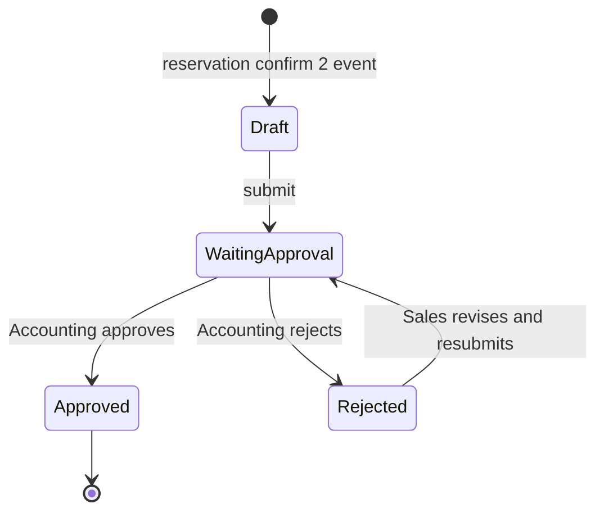

# Sales Validation

This feature exists as one of the standard operating procedures that need to be provided by Sales Service. Every reservation document need to be approved by Accounting team and revised by Sales Administration team if needed.

## Overview

<div class="doc-grid">
  <div class="doc-card">
    <div class="doc-card-label">✏️ Status</div>
    <div class="doc-card-value"><span class="badge gray">Draft</span></div>
  </div>
  <div class="doc-card">
    <div class="doc-card-label">👤 Owner</div>
    <div class="doc-card-value">Alfin Wijaya</div>
  </div>
  <div class="doc-card">
    <div class="doc-card-label">🧩 Related services</div>
    <div class="doc-card-value">Sales Service</div>
  </div>
</div>

## Goals

?> **🎯 Goals**
- Every reservation document is approved by Accounting team.
- Sales can revise a rejected reservation and resubmit it.
- Every Accounting team decision is recorded in an audit trail.

## Architecture

?> A reservation loops between **Pending approval** and **Rejected** until Accounting approves it. Approval ends the flow.



## Data creation

Sales Validation data is created automatically. There is no endpoint to create it.

?> When a reservation reaches `confirm 2` status for the first time (exclude reopen reservation), an event inserts the Sales Validation record and its Sales Validation Detail rows to their tables.

## Document revision sync

Sales team revises documents in the reservation menu, not in Sales Validation. When a document changes there, Sales Validation keeps its detail in sync.

<div class="doc-steps">
  <div class="doc-step">
    <span class="doc-step-num">1</span>
    <div class="doc-step-body">
      <div class="doc-step-title">Sales revises a document</div>
      <div class="doc-step-desc">Sales changes a document on the reservation. The change creates a new document log.</div>
    </div>
  </div>
  <div class="doc-step">
    <span class="doc-step-num">2</span>
    <div class="doc-step-body">
      <div class="doc-step-title">Find the matching detail</div>
      <div class="doc-step-desc">Sales Validation finds the Sales Validation Detail whose document log has the same document type as the changed document.</div>
    </div>
  </div>
  <div class="doc-step">
    <span class="doc-step-num">3</span>
    <div class="doc-step-body">
      <div class="doc-step-title">Update the document log</div>
      <div class="doc-step-desc">The detail's <code>document_log_id</code> is set to the new document log.</div>
    </div>
  </div>
</div>

!> **Warning:** The update only happens while the Sales Validation status is `draft` or `rejected`. When the status is `waiting approval` or `approved`, `document_log_id` is not changed.

!> **Important:** While the Sales Validation status is `waiting approval`, Sales can't upload a new document or change a current document.

## Data model

### Sales Validation

| Field | Type | Description |
| :--- | :--- | :--- |
| `reservation_id` | `string` | Reservation being validated |
| `status` | `string` | Current validation status: `draft`, `waiting approval`, `approved` or `rejected`. See status values below. |
| `approved_date` | `string` | String date format when user approved |
| `rejected_date` | `string` | String date format when user rejected |

### Sales Validation Detail

| Field | Type | Description |
| :--- | :--- | :--- |
| `sales_validation_id` | `string` | Sales Validation record this detail belongs to |
| `is_need_revision` | `bool` | `true` when Accounting asked Sales to revise |
| `is_revise` | `bool` | `true` when Sales has revised the document |
| `document_log_id` | `string` | Document log entry being validated. Updated when Sales revises the document in the reservation menu, unless the status is `waiting approval` or `approved` |

### Sales Validation Detail Remark

| Field | Type | Description |
| :--- | :--- | :--- |
| `sales_validation_detail_id` | `string` | Sales Validation Detail record this remark is attached to |
| `reviewed_by` | `string` | User who reviewed and wrote the remark |
| `reviewed_at` | `datetime` | ISO 8601 timestamp of the review |
| `remark` | `string` | Reviewer's comment, such as the reason for rejection |

<details class="scalar-detail" open>
<summary>Status values</summary>

| Value | Meaning |
| :--- | :--- |
| <span class="badge gray">draft</span> | Reservation created, not yet submitted for approval |
| <span class="badge yellow">waiting approval</span> | Waiting for Accounting to decide |
| <span class="badge red">rejected</span> | Rejected by Accounting, waiting for Sales to revise and resubmit |
| <span class="badge green">approved</span> | Approved by Accounting, flow ended |

</details>

## API endpoints

### Paginated List

<div class="api-card">
  <div class="endpoint-bar">
    <span class="method get">GET</span>
    <code>/sales_validation</code>
  </div>
  <p class="api-desc">Lists paginated of reservations in the validation queue. Supports filtering by <code>project</code>, <code>company</code>, <code>confirm 2 date</code>, and <code>status</code>.</p>
</div>

**Responses**
- <span class="badge green">200</span> Data fetched
- <span class="badge red">500</span> Internal server error

<details class="scalar-detail">
<summary>Response Payload — <code>GET /sales_validation</code></summary>

```json
{
  "message": "Data got correctly",
  "meta": {},
  "data": {
    "items": [
      {
        "id": "string",
        "company_code": "string",
        "project_code": "string",
        "reservation_code": "string",
        "unit_code": "string",
        "confirm_2_date": "date",
        "ownership_name": "string",
        "status": "enum",
        "approved_date": "date",
        "created_by": "string",
        "created_at": "datetime",
        "updated_by": "string",
        "updated_at": "datetime"
      }
    ],
    "total": 0,
    "page": 1,
    "size": 1,
    "pages": 0,
    "next_page": 0,
    "previous_page": 0
  }
}
```

</details>

### Non-paginated List

<div class="api-card">
  <div class="endpoint-bar">
    <span class="method get">GET</span>
    <code>/sales_validation/no_page</code>
  </div>
  <p class="api-desc">Lists non-paginated of reservations in the validation queue. Supports filtering by <code>project</code>, <code>company</code>, <code>confirm 2 date</code>, and <code>status</code>.</p>
</div>

**Responses**
- <span class="badge green">200</span> Data fetched
- <span class="badge red">500</span> Internal server error

<details class="scalar-detail">
<summary>Response Payload — <code>GET /sales_validation/no_page</code></summary>

```json
{
  "message": "Data got correctly",
  "meta": {},
  "data": [
    {
      "id": "string",
      "company_code": "string",
      "project_code": "string",
      "reservation_code": "string",
      "unit_code": "string",
      "confirm_2_date": "date",
      "ownership_name": "string",
      "status": "enum",
      "approved_date": "date",
      "created_by": "string",
      "created_at": "datetime",
      "updated_by": "string",
      "updated_at": "datetime"
    }
  ]
}
```

</details>

### Detail

<div class="api-card">
  <div class="endpoint-bar">
    <span class="method get">GET</span>
    <code>/sales_validation/{id}</code>
  </div>
  <p class="api-desc">Retrieves one sales validation, including its detail and review remarks.</p>
</div>

**Responses**
- <span class="badge green">200</span> Data fetched
- <span class="badge yellow">404</span> Data not found
- <span class="badge red">500</span> Unexpected backend error

<details class="scalar-detail">
<summary>Response Payload — <code>GET /sales_validation/{id}</code></summary>

```json
{
  "message": "Data got correctly",
  "meta": {},
  "data": [
    {
      "id": "string",
      "company_code": "string",
      "project_code": "string",
      "reservation_code": "string",
      "unit_code": "string",
      "confirm_2_date": "date",
      "ownership_name": "string",
      "status": "enum",
      "approved_date": "date",
      "created_by": "string",
      "created_at": "datetime",
      "updated_by": "string",
      "updated_at": "datetime",
      "sales_person_name": "string",
      "confirm_1_date": "date",
      "perdana_number_of_installments": "integer",
      "riil_number_of_installments": "integer",
      "perdana_amount": "number",
      "sales_amount": "number",
      "no_interest_amount": "number",
      "ppnbm_amount": "number",
      "pph22_amount": "number",
      "interest_rate": "string",
      "interest_type": "enum",
      "profit_loss_brutto": "number",
      "note": "string",
      "internal_note": "string",
      "promo_description": "string",
      "promo_amount": "number",
      "internal_program_description": "string",
      "internal_program_amount": "number",
      "profit_loss_burtto_1": "number",
      "gift_description": "string",
      "gift_amount": "number",
      "profit_loss_netto": "number",
      "details": [
        {
          "id": "string",
          "sales_validation_id": "string",
          "is_need_revision": "boolean",
          "is_revise": "boolean",
          "document_log_id": "string",
          "file_name": "string",
          "file_url": "string",
          "document_type_id": "string",
          "document_type_description": "string",
          "iom_free_type": "enum",
          "is_active": "boolean",
          "remarks": [
            {
              "id": "string",
              "sales_validation_detail_id": "string",
              "reviewed_by": "string",
              "reviewed_at": "datetime",
              "remark": "string"
            }
          ]
        }
      ]
    }
  ]
}
```

</details>

### Submit

<div class="api-card">
  <div class="endpoint-bar">
    <span class="method put">PUT</span>
    <code>/sales_validation/{id}/submit</code>
  </div>
  <p class="api-desc">Sales submits a sales validation for approval.</p>
</div>

**Validation before submit**
If any check fails, the request returns `400` with a `message`, and nothing changes.
- Every Sales Validation Detail with `is_need_revision` set to `true` must have `is_revise` set to `true`.
- Every mandatory document listed in the `document_type_detail` table must exist in the validation's details.

**On submit**
`is_need_revision` and `is_revise` are both reset to `false` on all Sales Validation Detail rows of the validation.

**Responses**
- <span class="badge green">200</span> Submitted
- <span class="badge yellow">400</span> Data not pass validation `message`
- <span class="badge red">403</span> Caller is not Sales Admin
- <span class="badge yellow">404</span> Data not found
- <span class="badge yellow">409</span> Data is either `waiting approval` or `approved`
- <span class="badge red">500</span> Unexpected backend error

### Resync

<div class="api-card">
  <div class="endpoint-bar">
    <span class="method put">PUT</span>
    <code>/sales_validation/{id}/resync</code>
  </div>
  <p class="api-desc">Sales sync the document shown with document type master.</p>
</div>

**Responses**
- <span class="badge green">200</span> Resynced
- <span class="badge yellow">400</span> Data not pass validation `message`
- <span class="badge red">403</span> Caller is not Sales Admin
- <span class="badge yellow">404</span> Data not found
- <span class="badge yellow">409</span> Data is either `waiting approval` or `approved`
- <span class="badge red">500</span> Unexpected backend error

### Approve

<div class="api-card">
  <div class="endpoint-bar">
    <span class="method put">PUT</span>
    <code>/sales_validation/{id}/approve</code>
  </div>
  <p class="api-desc">Accounting approves a sales validation.</p>
</div>

**Responses**
- <span class="badge green">200</span> Approved
- <span class="badge red">403</span> Caller is not Accounting
- <span class="badge yellow">404</span> Sales validation not found
- <span class="badge yellow">409</span> Reservation is not pending approval
- <span class="badge red">500</span> Unexpected backend error

<details class="scalar-detail" open>
<summary>Request Payload — <code>PUT /sales_validation/{id}/approve</code></summary>

```json
{
  "remark": "string"
}
```

</details>

### Reject

<div class="api-card">
  <div class="endpoint-bar">
    <span class="method put">PUT</span>
    <code>/reservations/{id}/reject</code>
  </div>
  <p class="api-desc">Accounting rejects a sales validation and requests a revision.</p>
</div>

**Responses**
- <span class="badge green">200</span> Marked as rejected
- <span class="badge red">403</span> Caller is not Accounting
- <span class="badge yellow">404</span> Sales Validation not found
- <span class="badge yellow">409</span> Sales validation is not pending approval
- <span class="badge yellow">422</span> Missing rejection reason
- <span class="badge red">500</span> Unexpected backend error

<details class="scalar-detail" open>
<summary>Request Payload — <code>PUT /reservations/{id}/reject</code></summary>

```json
{
  "remark": "string",
  "details": [
    {
      "sales_validation_detail_id": "string",
      "reviewed_by": "string",
      "reviewed_at": "datetime",
      "remark": "string"
    }
  ]
}
```

</details>

## Authentication and permissions

| Role | Allowed |
| :--- | :--- |
| **Accounting** | `approve`, `reject` |
| **Sales** | `revise`, `resubmit` |
| **Others** | `read only` |

!> **Warning:** Role checks run on every endpoint. A caller with the wrong role gets `403`.

## Error handling

| Code | Meaning | Client action |
| :--- | :--- | :--- |
| <span class="badge yellow">400</span> | Data did not pass validation. The response has a `message` | Show the message and let the user correct the input |
| <span class="badge red">403</span> | Caller has the wrong role. Sales submits, Accounting approves and rejects | Hide the action for this user |
| <span class="badge yellow">404</span> | Sales Validation not found | Refresh the list. The record may not exist yet |
| <span class="badge yellow">409</span> | Invalid status transition, such as submitting when `waiting approval` or `approved`, or approving or rejecting when not `waiting approval` | Refresh the Sales Validation and check its status |
| <span class="badge yellow">422</span> | Rejection has no remark | Ask the reviewer to provide a remark |
| <span class="badge red">500</span> | Unexpected backend error | Retry later. If it keeps failing, contact the backend team |

## Configuration

| Variable | Default | Description |
| :--- | :--- | :--- |
| `SALES_VALIDATION_FLOW_ID` | `null` | Workflow approval setting id |

## Testing

- **Unit tests:** Every valid and invalid status transition.
- **Integration tests:** The audit trail is written on every decision.
- **Access tests:** Role-based access for each endpoint.